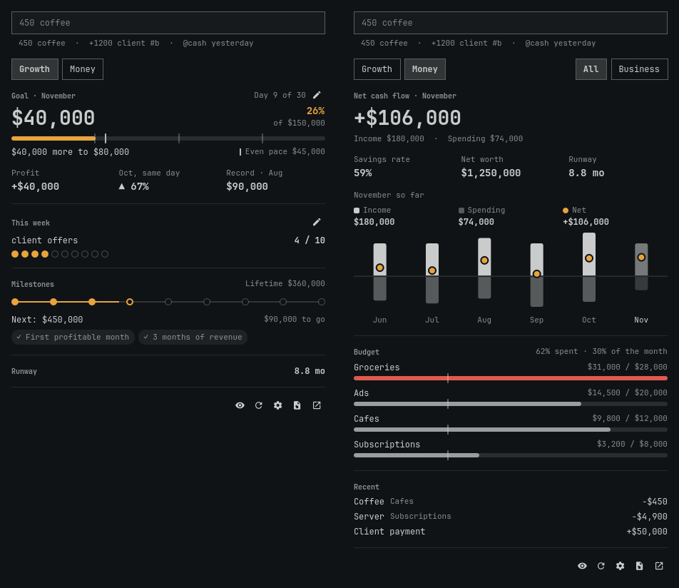
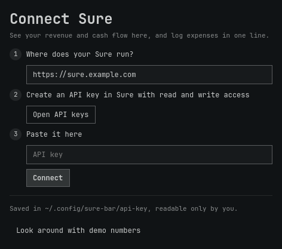
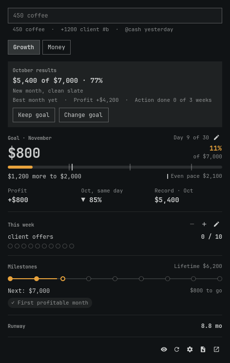
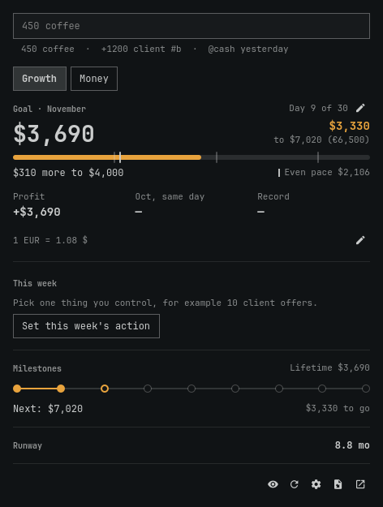

# Sure Bar

Your monthly revenue goal, cash flow and one-line expense entry in the [Omarchy](https://omarchy.org) bar, backed by your own [Sure](https://github.com/we-promise/sure), on this computer or on a VPS.



This is an unofficial plugin and is not affiliated with the Sure project.

## What you get

- **In the bar:** this month's revenue and how far along your goal you are, for example `2.3k 33%`. Without a goal it shows whether you are ahead of last month, for example `40k ▲`. It turns red only for a real problem: a budget that is overspent, or under three months of runway.
- **Goal:** a monthly revenue goal you choose, broken into round stages, with profit right beside it.
- **Action of the week:** one thing you control, with a counter.
- **Growth:** the comparison with last month and your best month, a ladder of lifetime milestones, your runway, and a review of last month against its goal.
- **Money:** net cash flow, six months of income and spending, budgets paced against the calendar, and recent transactions, for everything or just the business.
- **One-line entry:** type, check the preview, press Enter. Undo from the notification.
- **Any Sure currency:** with manual rates for business money and goals in another currency.
- **Local or VPS:** connection problems are named, and the last real numbers stay on screen when the server can't be reached.

| Connect | Month review | Goal in another currency |
| --- | --- | --- |
|  |  |  |

## Requirements

- Omarchy with the shell plugin system
- A recent Sure release, on this computer or on a server you can reach (checked against the `stable` and `latest` images every night)
- A Sure API key with read and write access. A read-only key works for viewing, but entries can't be saved.

## Install

```bash
omarchy plugin add https://github.com/andreiyurik/omarchy-sure-bar --enable
```

Click the widget and follow the connect screen. Enter where Sure runs, create an API key, and paste it. The plugin checks both before saving anything, and says what's wrong if it can't connect. Until an account exists in Sure, the panel shows demo numbers. The gear button in the panel brings this screen back.

To update later:

```bash
omarchy plugin update andreiyurik.sure-bar
```

## Adding entries

| You type | What is saved |
| --- | --- |
| `450 coffee` | Expense of 450 |
| `+1200 client #b` | Income of 1200, tagged as business |
| `1.5k lunch` | Expense of 1500 |
| `4900 server #b @cash yesterday` | Expense on the account matching "cash", dated yesterday |

`#b` is short for your business tag. Any other `#word` is saved as that tag, and missing tags are created. An entry with a name you have used before reuses that category. Russian also works: `1.5к обед #б @нал вчера`.

In the panel, Tab switches between Growth and Money, and Esc closes it.

## Goals

The same line sets your goals, and the buttons on the Growth view fill it in for you.

| You type | What it does |
| --- | --- |
| `goal 7000` | Revenue goal of 7000 a month, from this month on |
| `week 10 client offers` | This week's action: 10 client offers |
| `goal off`, `week off` | Removes it |

Russian works too: `цель 7000`, `неделя 10 предложений клиентам`.

With the entry line empty, ↑ and ↓ change the weekly count. The action carries over to the next week with a clean count. On the 1st, the race starts again and last month's result waits in a short review until you dismiss it.

A goal is in your Sure default currency unless you name another, as in `goal 7000 USD`. Changing a goal applies from the current month, so past reviews keep the goal they had.

### Why it works this way

The design draws on published research. None of these studies tested a finance widget, and many were run in health, education or lab settings, so treat this as informed design, not proof that it raises income.

| Choice | Research |
| --- | --- |
| One specific, hard goal | [Locke & Latham, 2002](https://doi.org/10.1037/0003-066X.57.9.705) |
| Stages, so the middle of the month doesn't sag | [Kivetz et al., 2006](https://doi.org/10.1509/jmkr.43.1.39); [Bonezzi et al., 2011](https://doi.org/10.1177/0956797611404899) |
| Percent done early, amount left after halfway | [Koo & Fishbach, 2012](https://doi.org/10.1086/663827) |
| An action you control, because revenue isn't only up to you | [Seijts & Latham, 2005](https://doi.org/10.5465/ame.2005.15841964) |
| Progress written down and visible | [Harkin et al., 2016](https://doi.org/10.1037/bul0000025) |
| A clean start each month | [Dai et al., 2014](https://doi.org/10.1287/mnsc.2014.1901) |
| No points or loot; profit next to revenue; no ceiling at 100% | [Deci et al., 1999](https://doi.org/10.1037/0033-2909.125.6.627); [Ordóñez et al., 2009](https://doi.org/10.5465/amp.2009.37007999) |
| No revenue streaks | [Silverman & Barasch, 2023](https://doi.org/10.1093/jcr/ucac029) |

## Currencies

Amounts use the symbol and precision your Sure defines, and the number format of your language. Cents appear where they matter: `$9.50`, `$7,000`, `₿0.5`. Entries understand `1,500`, `1.234,56` and, on a currency with three decimals, `1.234`. An entry is saved in the currency of its account.

Sure converts its overall totals itself. Its API doesn't share exchange rates, so for business revenue in another currency you give the plugin a rate:

| You type | What it does |
| --- | --- |
| `rate USD 92` | 1 USD counts as 92 in your Sure default currency |
| `rate USD off` | Removes it |
| `goal 7000 USD` | A goal in dollars, compared using that rate |

Without a rate, that money isn't guessed at: the panel shows how much is left out and offers to add one. One rate per currency applies to every month, so changing it changes past totals. Rates are never fetched from the internet, so the plugin still talks only to your Sure.

## Sure on a VPS

Everything works the same as on your own computer. A few things are worth setting up:

- **Use HTTPS.** Your API key travels with every request, so plain HTTP is allowed only for `localhost` unless you turn on the setting. With [Caddy](https://caddyserver.com), this is all it takes:
  ```
  sure.example.com {
  	reverse_proxy localhost:3000
  }
  ```
  Without a domain, use `tailscale serve`, or an SSH tunnel and `http://localhost:3000` as the address: `ssh -N -L 3000:localhost:3000 you@server`.
- **Keep `SELF_HOSTED=true`,** as in Sure's example compose file. Without it Sure limits an API key to 100 requests an hour.
- **Set the timezone in Sure's settings.** Servers often run in UTC. If Sure's timezone differs from your computer's, the panel tells you once.
- **If a login page protects Sure** (Authelia, Cloudflare Access), let `/api` through. API keys can't pass a login page.
- **A view-only key is fine** if you'd rather not keep a key that can write. Viewing and goals work, and entries are turned off.

When the server can't be reached, the panel keeps your last real numbers and says how old they are. It tries again by itself, and refreshes after the computer wakes up. If a reply gets lost while saving an entry, press Enter again: Sure won't save it twice.

## Optional hotkey

Add to `~/.config/hypr/bindings.lua`:

```lua
o.bind("SUPER + ALT + M", "Sure finance panel", "omarchy-shell shell toggle andreiyurik.sure-bar")
```

## Settings

| Setting | Default | What it does |
| --- | --- | --- |
| Sure URL | `http://localhost:3000` | Where your Sure runs. The connect screen sets this for you. |
| Allow plain HTTP to non-local hosts | off | See [Privacy and network](#privacy-and-network) |
| Refresh in the background | on | Also retries after failures, refreshes after sleep and when you open old data. Turn off to fetch only when you press refresh or save an entry. |
| Refresh interval | 10 minutes | 1 to 120 |
| Business tag | `business` | Transactions with this tag count as business |
| Count all income as revenue | off | Ignores the tag, for people who don't separate business money |
| Default account | empty | Part of an account name. Otherwise the last used account is chosen. |
| Show demo data | off | Fake numbers, handy for screenshots |

## How the numbers work

- Revenue is income on transactions with your business tag. The goal, milestones and the race are recalculated from your transactions every time, so there is no separate game state to lose.
- Closed months and older revenue are kept locally so refreshes stay quick. Everything is read again once a day and whenever you press refresh.
- Transfers between your own accounts are ignored. A refund from a supplier looks like income in Sure, so tagging one as business counts it as revenue.
- Business transactions in a currency other than your Sure default count once you set a rate for it. Until then the panel says what is left out.
- At most the latest 3,000 matching transactions are read. If you have more, the panel warns that lifetime revenue and milestones may be low.
- The panel warns once if Sure's timezone differs from your computer's, because entries near midnight can land on the wrong day.

## Privacy and network

- The plugin talks only to the Sure URL you set. It has no analytics and no other network access. When a connection fails, it also runs `curl` against that URL, without your key, to find out why.
- While background refresh is on, it makes requests to Sure at the interval you set.
- Your API key is stored in `~/.config/sure-bar/api-key`, readable only by you, and never leaves for anywhere but your Sure server.
- Plain HTTP is allowed only for `localhost` and `127.x.x.x` unless you turn on the setting, because it would send your key unencrypted.
- Your goals and weekly actions are stored only in `~/.config/sure-bar/plan.json`, readable only by you. The last numbers, kept for when Sure can't be reached, are in `snapshot.json` next to it, with the same protection.
- The eye button hides amounts in the bar and the panel, for screen sharing. The choice is remembered in `~/.config/sure-bar/hide-amounts`.
- Removing the plugin leaves `~/.config/sure-bar` in place. Delete that folder to remove the key.

## Languages

English and Russian, following your Omarchy language. Translations live in `i18n/`. Anything missing falls back to English, and new language files are welcome.

## Development

```bash
node tests/model.test.js      # calculations, dates, parsing
node tests/project.test.js    # translations and code rules
node tests/service.test.js    # the real service against a fake Sure that misbehaves; needs quickshell

tests/vps/up.sh               # a real Sure behind HTTPS, with a network that can be slowed or cut
NODE_EXTRA_CA_CERTS=~/.cache/sure-bar-vps/ca.crt node tests/contract.test.js
node tests/vps/e2e.test.js
docker compose -f tests/vps/compose.yml down
```

CI runs the first three, and checks the API contract against Sure's `stable` and `latest` images every night. When a newer Sure adds currencies, regenerate the table:

```bash
docker run --rm -i --entrypoint ruby ghcr.io/we-promise/sure:latest - < tests/vps/currencies.rb > Currencies.js
```

## License

[MIT](LICENSE)
